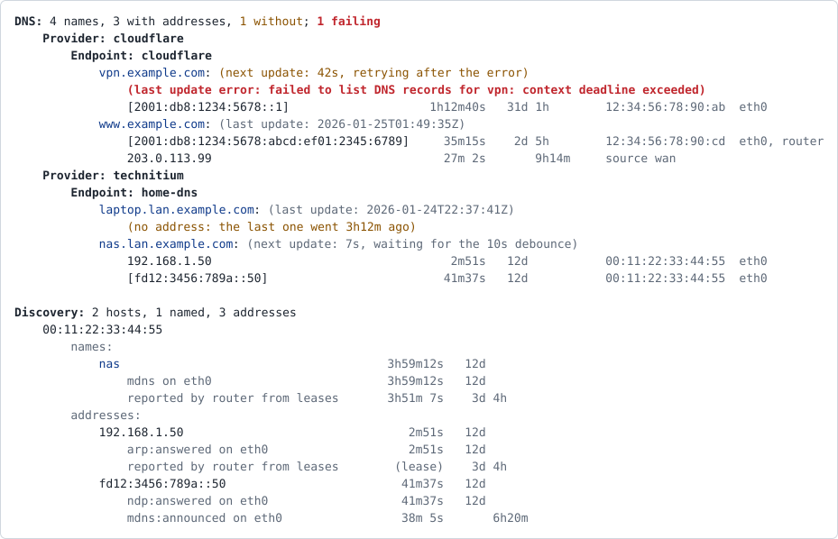

# ipv6ddns

[](https://github.com/miguelangel-nubla/ipv6ddns/actions/workflows/ci.yaml)
[](https://github.com/miguelangel-nubla/ipv6ddns/releases/latest)

**DNS names for every device on your network, on the LAN and on the internet, wherever its addresses move.**

<picture>
  <source media="(prefers-color-scheme: dark)" srcset="docs/images/architecture-dark.svg">
  
</picture>

ipv6ddns finds every host on your LAN, over IPv6 and IPv4, and keeps a DNS name pointing at each one. The names can live at your DNS provider, at your router, or in ipv6ddns itself, acting as the LAN's DNS server. You install nothing on the devices and need no static addresses.

- **Dynamic DNS for any device.** A server, a camera or a container is found by its MAC address, and its name is kept up to date at Cloudflare, Route 53, deSEC, Hetzner, DuckDNS and others. The name can carry the network's public IPv4 next to the device's IPv6. When your ISP changes the IPv6 prefix, or a laptop picks a new address, `myserver.example.com` keeps working.
- **Every machine by name, with nothing to set per host.** Each host gets the name it calls itself, such as `printer.lan.example.com` or `laptop.lan.example.com`. Names appear and disappear as hosts come and go.
- **The LAN's DNS server, if you want one.** ipv6ddns can answer those names itself, along with records you write and the reverse names. It forwards every other query, over TLS or HTTPS if you like, and caches the answers.

It runs on one machine on the network. It can also run as a [Home Assistant app](homeassistant/addon/DOCS.md) (formerly called an add-on), which makes it a device in Home Assistant too.

## What you can do with it

| You want | Start here |
|---|---|
| Every machine on the network reachable by name, from every device | [Guide: every machine on the network by name](docs/guides/network-wide-names.md) |
| A server's public name kept up to date when its IPv6 prefix changes | [Quick start](#quick-start), then [filtering](docs/filtering.md) to choose which of its addresses |
| Home Assistant itself at a public name, such as `ha.example.com` | [The app: publishing Home Assistant](homeassistant/addon/DOCS.md#publishing-home-assistant-itself) |
| The names in your router's DNS: MikroTik, OpenWrt, OPNsense, pfSense, UniFi | [Your router's DNS instead](docs/guides/network-wide-names.md#your-routers-dns-instead), and the [providers reference](docs/reference/providers.md) |
| A DNS server for the LAN, with your own records | [The resolver](docs/resolver.md) |
| The network's public IPv4 under the same name as the IPv6 | [Sources](docs/sources.md) |

There is more in the [guides](docs/guides/README.md), and in the [guides for the Home Assistant app](docs/guides/home-assistant/README.md).

## What it looks like

The web report, or `--live` in a terminal, shows each name, with its addresses and the state of its updates, then the built-in DNS server if you use it, and each host found, with its names and how each address was seen.

<picture>
  <source media="(prefers-color-scheme: dark)" srcset="docs/images/report-dark.svg">
  
</picture>

The two times on each line are how long the address has left before it expires, and how long it has been seen. In a browser and in a terminal the report has colors: red for what fails, amber for what waits or has no address, green for what works. The words say the same without them. The same state is served as JSON at `/status.json`, and as Prometheus metrics at `/metrics`.

## How it works

1. **Discovery** finds the hosts on the network and their addresses, each identified by its MAC. It listens to the network, probes it, and reads your routers' tables, for IPv6 and for local IPv4. It also learns what each host calls itself, from mDNS, DHCP, NetBIOS and other protocols.
2. **Tasks** give names their addresses. A task's filters choose which addresses it takes: this MAC, only global addresses, only the stable one. A task's name can also be a template, such as `{hostname}`, which makes a name for every host the task matches.
3. **Sources** add addresses that have no MAC: the network's public IPv4, a command's output, or a Home Assistant entity.
4. **The names are kept up to date** wherever you choose, as the addresses change:
   - at a DNS provider, a router or the DNS server you already run: Cloudflare, Route 53, deSEC, Hetzner, DuckDNS, MikroTik, OpenWrt, pfSense, OPNsense, UniFi, AdGuard Home, Pi-hole, Technitium, Windows DNS, Gravity, and any server that takes RFC 2136 updates, such as BIND;
   - or in a zone of ipv6ddns's own [resolver](docs/resolver.md), which the LAN's devices query.

[How it works](docs/how-it-works.md) explains the problem with DDNS on IPv6, why ipv6ddns is designed this way, and what else it can do, such as a name on a network with several ISPs: see [multi-WAN](docs/guides/multi-wan.md).

## Quick start

This `config.yaml` keeps one server's global addresses at Cloudflare:

```yaml
webserver:
  listen: 127.0.0.1:8053

tasks:
  webserver:
    filter:
      - mac:
          address: "00:11:22:33:44:55"
        ip:
          type:
            - global
    endpoints:
      cloudflare:
        - www           # www.example.com

credentials:
  cloudflare:
    provider: cloudflare
    settings:
      api_token: ${CLOUDFLARE_TOKEN}
      zone: example.com
      ttl: 1h
      proxied: false
```

Run it with Docker, on the host's network and with `CLOUDFLARE_TOKEN` in its environment: see [installation](docs/installation.md#with-docker-compose). The report is then at `http://127.0.0.1:8053`.

For a complete setup, pick a [guide](docs/guides/README.md) instead.

## Install

- **Binaries** for Linux, macOS, FreeBSD and the other BSDs are on the [releases page](https://github.com/miguelangel-nubla/ipv6ddns/releases). Discovery listens to the network, so it needs [a few privileges](docs/installation.md#what-discovery-needs).
- **Packages** for Debian and Ubuntu (`.deb`), Fedora and RHEL (`.rpm`), Arch (`.pkg.tar.zst`) and Alpine (`.apk`) are on the same page. They install ipv6ddns as a service, with a starting configuration. See [as a service](docs/installation.md#as-a-service).
- **NixOS**: the repository is a flake, with a module. See [on NixOS](docs/installation.md#on-nixos).
- **Homebrew**, on macOS: `brew install miguelangel-nubla/tap/ipv6ddns`.
- **Docker**: run `ghcr.io/miguelangel-nubla/ipv6ddns` on the host's network. See [installation](docs/installation.md).
- **Home Assistant**: install [the app](homeassistant/addon/DOCS.md).

## Documentation

The full index is in [docs](docs/README.md).

| | |
|---|---|
| **Getting started** | |
| [Installation and running](docs/installation.md) | Binaries, packages, Docker, flags, the web report, health and metrics, several instances at once |
| [Guides](docs/guides/README.md) | Common setups from start to end, also [for the Home Assistant app](docs/guides/home-assistant/README.md) |
| **Configuring** | |
| [Configuration](docs/configuration.md) | The file's structure, secrets, validation |
| [Filtering](docs/filtering.md) | Choosing which addresses a name gets |
| [Discovery](docs/discovery.md) | How hosts are found: IPv6 and IPv4, the protocols, the hosts' names, plugins, interfaces, lifetimes |
| [Names by the hosts' names](docs/hostnames.md) | A name for every host on the LAN, from what the host calls itself: `{hostname}`, `{n}`, `{mac}` |
| [Sources](docs/sources.md) | The public IPv4, and other addresses without a MAC |
| [Resolver](docs/resolver.md) | ipv6ddns as the LAN's DNS server: its zones, records, and what it forwards |
| **Home Assistant** | |
| [The app](homeassistant/addon/DOCS.md) | Installing it, its configuration, and [how it is made](docs/home-assistant.md) |
| [The integration](docs/home-assistant-integration.md) | ipv6ddns as a device in Home Assistant, and entity states used as addresses |
| **Platforms** | |
| [MikroTik](docs/mikrotik.md) | RouterOS as a DNS provider, a discovery plugin, and a container host |
| [UniFi](docs/unifi.md) | A UniFi gateway as a DNS provider, a discovery plugin, and a source of its public addresses |
| [OpenWrt](docs/openwrt.md) | dnsmasq as a DNS provider, the router as a discovery plugin, and a source of its public addresses |
| [OPNsense](docs/opnsense.md) | Unbound as a DNS provider, the firewall as a discovery plugin, and a source of its public addresses |
| [pfSense](docs/pfsense.md) | The DNS Resolver as a DNS provider, the firewall as a discovery plugin, and a source of its public addresses |
| **Reference** | |
| [Configuration reference](docs/reference/configuration.md) | Every key, generated from the schema |
| [Providers reference](docs/reference/providers.md) | Every provider's settings |
| **Background** | |
| [How it works](docs/how-it-works.md) | The problem, and the design |

Host discovery is done by the [ipv6disc](https://github.com/miguelangel-nubla/ipv6disc) library, which you can also use on its own.

To contribute, for example by adding a DNS provider, see [CONTRIBUTING.md](CONTRIBUTING.md). To report a security issue, see [SECURITY.md](SECURITY.md).
