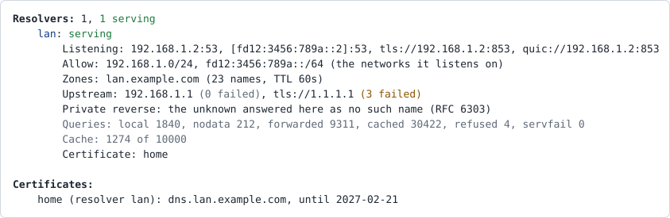

# The resolver

ipv6ddns can be the DNS server of your network. A resolver answers three kinds of query:

- **The names your tasks publish** in its zones, with the addresses discovery finds for them, as soon as it finds them. A zone is a credential with the provider `resolver`.
- **Records you write** yourself.
- **Everything else**, which it forwards to its upstream servers, such as your router or a public resolver.

Give the devices the resolver's address as their DNS server, by DHCP or in the router's advertisements. A name on the LAN, such as `nas.lan.example.com`, then follows its host wherever its addresses move, and there is no other DNS server to update.

Nothing is sent to a provider. An update of a zone happens in memory, takes effect at once, and never fails.

```yaml
resolvers:
  lan:                                    # the resolver's name; you can have several
    listen: 192.168.1.0/24                # the machine's address in this network, port 53
    allow:                                # the clients it answers; default: the networks it listens on
      - 192.168.1.0/24
      - fd00::/64
    upstream:                             # the servers it asks for every other name, in order
      - 192.168.1.1
      - 1.1.1.1
    cache_size: 10000                     # how many upstream answers it caches (the default)
    records:                              # records for names outside its zones, written in full
      - www.example.com. CNAME nas.lan.example.com.

credentials:
  home:
    provider: resolver                    # a zone the resolver answers
    settings:
      resolver: lan                       # needed only with more than one resolver
      zone: lan.example.com
      records:                            # relative to the zone, or absolute within it
        - printer A 192.168.1.20
        - files CNAME nas
        - _ipp._tcp SRV 0 0 631 printer

tasks:
  nas:
    filter:
      - mac:
          address: "00:11:22:33:44:55"
    endpoints:
      home:                               # nas.lan.example.com
        - nas
```

Every key is in the reference: [`resolvers`](reference/configuration.md#resolvers), and [the provider's settings](reference/providers.md#resolver). For a whole setup, see the guide [every machine on the network by name](guides/network-wide-names.md).

## A resolver

Each entry under `resolvers` is one resolver, with a name of your choice. Its keys:

### `listen` (required)

Where the resolver answers, over UDP and TCP. It takes the same forms as [`webserver.listen`](installation.md#the-web-report):

- a network, such as `192.168.1.0/24`, which means each of the machine's addresses in that network;
- an address, such as `192.168.1.2` or `[fd00::2]:5353`;
- a host name;
- a port alone, which means every address of the machine.

Without a port, the port is 53.

On a router, a port alone includes the router's public address. Give the clients' network there instead.

An entry that starts with `tls://`, `https://` or `quic://` answers over that encrypted transport instead of plain DNS: see [encrypted DNS for the clients](#encrypted-dns-for-the-clients).

### `allow`

The networks or addresses of the clients the resolver answers. Any other client gets `REFUSED`.

By default, `allow` is the networks of the machine's addresses the resolver listens on. In the example above that is `192.168.1.0/24`, taken from the machine's interface. With a port alone, the default is every network of the machine.

### `upstream` (required)

One or more servers the resolver asks for every name that isn't its own. Each is an address or a host name, with or without a port:

- Over plain DNS: `192.168.1.1`, `1.1.1.1:53`, `[2606:4700:4700::1111]` or `dns.example.net`.
- [Encrypted](#encrypted-upstream-servers): `tls://1.1.1.1` for DNS over TLS, or `https://dns.example.net/dns-query` for DNS over HTTPS.

### `bootstrap`

Servers that look up the addresses of an upstream given by host name. You need `bootstrap` only when an upstream is a host name, and the bootstrap servers are asked nothing else. Write them as addresses, with or without a port. They are asked over plain DNS.

The system's resolver isn't used for this lookup, because it may be this very resolver, which would be asking itself.

```yaml
resolvers:
  lan:
    listen: 192.168.1.0/24
    upstream:
      - dns.example.net
      - 1.1.1.1
    bootstrap:
      - 9.9.9.9
```

How the lookup behaves:

- The addresses found, IPv4 and IPv6, are tried in turn, as one upstream server.
- They are kept for as long as the answer says, but at least a minute and at most an hour.
- While the bootstrap servers don't answer, they are asked again every 10 seconds.
- An upstream whose addresses were never found is skipped, like one that is down.

### `records`

Records for names outside all of the resolver's zones. For example, a public domain's name that the LAN should reach at a local address. Write each name in full, with its trailing dot, and write the targets the same way.

### `cache_size`

How many upstream answers the resolver keeps in [its cache](#the-cache): `10000` by default, `0` for none.

## Encrypted upstream servers

The resolver can ask an upstream server over an encrypted connection. The network in between, such as your ISP's, then can't read the names asked or change the answers.

- **`tls://host[:port]`** is DNS over TLS ([RFC 7858](https://www.rfc-editor.org/rfc/rfc7858)). The port is 853 unless you give another. Nothing goes after the host: a path is only for `https://`.
- **`https://host[:port]/path`** is DNS over HTTPS ([RFC 8484](https://www.rfc-editor.org/rfc/rfc8484)). The port is 443 unless you give another. The path is where the server answers, and you have to give it. For most servers it is `/dns-query`. Each query is a `POST` of `application/dns-message`, over HTTP/2 when the server supports it. Redirects aren't followed.

```yaml
resolvers:
  lan:
    listen: 192.168.1.0/24
    upstream:
      - https://dns.quad9.net/dns-query   # found by bootstrap
      - tls://1.1.1.1                     # an address: no bootstrap for it
      - 192.168.1.1                       # the router, when neither answers
    bootstrap:
      - 9.9.9.9
```

The host is either an address or a host name. A host name is looked up through `bootstrap`, just as for a plain upstream.

### The certificate

The server's certificate is always verified against the system's certificate authorities, for the host as you wrote it:

- For a host name, the certificate must be for that name. The connection also asks for that name (its SNI).
- For an address, the certificate must contain that address. The certificate of `1.1.1.1` does, but few others do.

There's no option to turn verification off. A server whose certificate doesn't verify is skipped, like one that is down, and counts in `ipv6ddns_resolver_upstream_failures_total`.

On Linux, Go reads the system's certificate authorities from the usual places of each distribution. To use others instead, for a server whose certificate comes from your own authority, set the environment variable `SSL_CERT_FILE` (a file of PEM certificates) or `SSL_CERT_DIR` (directories of them).

The Docker image has Alpine's `ca-certificates`. Another image must have certificate authorities too, or no certificate verifies: `x509: certificate signed by unknown authority`.

### Connections

Connections are kept and reused:

- **DNS over TLS:** a connection carries one query at a time, and stays open for the next query for 30 seconds. Queries made at the same time each get their own connection, and each connection closes after 30 seconds without a query. If the server closed a connection in the meantime, the resolver opens a new one and asks the query again on it.
- **DNS over HTTPS:** there is one client, and HTTP/2 shares its connections among concurrent queries. Each connection closes after 30 seconds without a query. The client connects only to the addresses `bootstrap` found, or to the address you gave. It doesn't use a proxy from the environment.

Encrypted queries are padded to a multiple of 128 bytes, as [RFC 8467](https://www.rfc-editor.org/rfc/rfc8467) recommends, so their size says less about the name asked.

Everything else works as for any upstream: each server gets 2 seconds, then the next one is asked, and the client gets `SERVFAIL` when none answers. The status and the metrics name an encrypted upstream as you wrote it.

## Encrypted DNS for the clients

The resolver can also answer the clients over an encrypted connection, so that nobody on the LAN, such as another device on the Wi-Fi, can read the names asked or change the answers. Phones, computers and browsers can be set to use it, as [below](#setting-up-the-clients).

Each transport is a `listen` entry with its scheme. It takes the same forms as a plain entry, and has its own default port:

- **`tls://`** is DNS over TLS ([RFC 7858](https://www.rfc-editor.org/rfc/rfc7858)), TCP port 853.
- **`https://`** is DNS over HTTPS ([RFC 8484](https://www.rfc-editor.org/rfc/rfc8484)), TCP port 443, at the path `/dns-query`, by `GET` and by `POST`, over HTTP/1.1 and HTTP/2.
- **`quic://`** is DNS over QUIC ([RFC 9250](https://www.rfc-editor.org/rfc/rfc9250)), UDP port 853.

```yaml
resolvers:
  lan:
    listen:
      - 192.168.1.0/24          # plain DNS, port 53
      - tls://192.168.1.0/24    # DNS over TLS, port 853
      - https://192.168.1.0/24  # DNS over HTTPS, port 443
      - quic://192.168.1.0/24   # DNS over QUIC, port 853
    tls: home                   # the certificate, of certificates
    upstream:
      - 192.168.1.1

certificates:
  home:
    certificate: /etc/ssl/dns/fullchain.pem
    key: /etc/ssl/dns/privkey.pem

credentials:
  home:
    provider: resolver
    settings:
      zone: lan.example.com
      records:
        - dns A 192.168.1.2     # the name in the certificate, at this machine
```

Everything else is the same on every transport: the same answers, the same [`allow`](#allow), the same counts in the status and the metrics. The status lists each encrypted address with its scheme, as `tls://192.168.1.2:853`.

### The certificate it shows

The encrypted transports show a certificate of the top-level `certificates`, which `tls` names. Each certificate has a name of your choice, and either `certificate` and `key`, the files of the certificate with its chain, and of its private key, in PEM, relative to the configuration's folder unless absolute, or [`acme`](#a-certificate-from-lets-encrypt). Let's Encrypt names the files `fullchain.pem` and `privkey.pem`. ipv6ddns doesn't start if they don't read as a pair.

Several servers can show one certificate: resolvers, and the web server's [HTTPS](installation.md#over-https), each with the same `tls`. It is read once, and with `acme` got and renewed once, for all of them, so give it every name the clients use. Two certificates can't share a file, and a certificate that no server shows stops the start, so a mistyped name doesn't go unnoticed.

Clients check the certificate. Most of them only accept one that a public authority signed, for the name they were told to use. So pick a name in a domain you own, such as `dns.lan.example.com`, and give it this machine's address, as the record `dns A 192.168.1.2` above: the clients look this name up, and the certificate is for it. Then either let ipv6ddns get the certificate, as [below](#a-certificate-from-lets-encrypt), or get it yourself: with certbot, acme.sh, or the Home Assistant app of Let's Encrypt, by the DNS challenge, which works for a name that the internet can't reach. When a renewal writes new files, the resolver takes them within seconds, without a restart.

A name in `home.arpa`, or a certificate you signed yourself, only works with clients you can give your own authority to, such as `dig` and `kdig` on Linux.

The report names the certificate under its resolver, and has a `Certificates:` section: each certificate, the servers that show it, its names, and until when, in amber two weeks before it expires, and in red once it has. If a renewed file doesn't read, the servers keep showing the certificate they had, and the report and the log say why. `/status.json` has them as `certificates`.

### A certificate from Let's Encrypt

With `acme`, ipv6ddns gets the certificate itself, from Let's Encrypt, and renews it. It proves the name is yours by the DNS challenge: it writes a TXT record, `_acme-challenge.dns.lan.example.com`, at the DNS provider of your public domain, which Let's Encrypt reads, and removes it after. The name needs no address on the internet.

```yaml
resolvers:
  lan:
    listen:
      - 192.168.1.0/24
      - tls://192.168.1.0/24
    tls: home
    upstream:
      - 192.168.1.1

certificates:
  home:
    acme:
      names:
        - dns.lan                  # dns.lan.example.com, in the zone of the credential
      credential: public

credentials:
  public:                          # your public domain, at its DNS provider
    provider: cloudflare
    settings:
      api_token: ${file:cloudflare_token}
      zone: example.com
      ttl: 1h
      proxied: false
  home:
    provider: resolver
    settings:
      zone: lan.example.com
      records:
        - dns A 192.168.1.2        # the name in the certificate, at this machine
```

- **`names`** are the names the certificate is for, relative to the zone of `credential`, as an endpoint's names are. A wildcard, as `*.lan`, is one too.
- **`credential`** is the credential of your public zone, which writes the challenge's record. Its provider must be `cloudflare`, `route53`, `rfc2136` or `duckdns`. A DuckDNS name has one TXT record, so its certificate can only be for that name.
- **`email`** is an address Let's Encrypt may write to about the account. It no longer sends mail about certificates that end. Optional.
- **`directory`** is the authority, Let's Encrypt by default. Its staging directory, `https://acme-staging-v02.api.letsencrypt.org/directory`, has no limits but signs certificates that no client trusts: use it to try the setup.

The certificate and its key go to the certificate's `certificate` and `key`, by default `tls/<name>/fullchain.pem` and `privkey.pem` in the configuration's folder, as `tls/home/`, with the account's key, `acme-account.key`, beside them. Keep that folder across restarts and updates: a certificate is got again only when it's due.

- **At the first start** there is no certificate yet. The resolver answers plain DNS at once, and refuses the encrypted connections for the minute or so it takes. The report says `home (resolver lan): none yet`.
- **Renewal** comes once two thirds of the certificate's lifetime have passed, 30 days before the end of one of 90 days, without a restart.
- **A failed attempt** is tried again an hour later. The report and the log say why, and the resolver keeps showing the certificate it has meanwhile.

### Setting up the clients

| Client | Transport | Where |
|---|---|---|
| Android 9 and later | TLS | *Settings → Network → Private DNS*: the name, `dns.lan.example.com` |
| iPhone, iPad and Mac | TLS or HTTPS | A configuration profile of DNS settings, with the name or the URL |
| Windows 11 | HTTPS | *Settings → Network → DNS server assignment*: the address, with DNS over HTTPS on and the template `https://dns.lan.example.com/dns-query` |
| Firefox and Chrome | HTTPS | Their secure DNS setting, with a custom provider: `https://dns.lan.example.com/dns-query` |
| Linux with systemd-resolved | TLS | `DNS=192.168.1.2#dns.lan.example.com` and `DNSOverTLS=yes` |
| AdGuard's apps, dnsproxy | QUIC | `quic://dns.lan.example.com` |

A client that uses the name finds it through the DNS it has already, so the name needs its record in the resolver's zone, or at your DNS provider.

### Ports

Port 443 is often taken already, by a reverse proxy or a web interface. Give DNS over HTTPS another port, as `https://192.168.1.2:8443`, or another address, and write that port in the clients' URL. DNS over TLS and DNS over QUIC can share port 853, one over TCP and the other over UDP.

## A zone

A credential with the provider `resolver` is a zone that a resolver answers. Its settings:

- **`zone`** is the zone's name.
- **`resolver`** is the name of the resolver that answers it. You can leave it out when there's only one resolver.
- **`records`** are records for the zone's other names, the ones no task publishes. Write each name relative to the zone, or in full within it, such as `printer.lan.example.com.`.
- **`ttl`** is the TTL of a name's addresses, and of the zone's records that don't give their own. It is `1m` by default. An answer never outlasts its addresses: when one of them expires sooner than `ttl`, the answer has the time it has left, so clients drop it when the resolver does.

The names in the zone come from the tasks' endpoints, as for any provider: `nas` is `nas.lan.example.com`, `""` is `lan.example.com` itself, and `"*.nas"` is a wildcard.

The credential's [`debounce`](configuration.md#its-parts) is zero by default for this provider, so a change is answered at once.

A zone with no task still serves its records.

Two resolvers can each have a zone with the same name, through two credentials. The same name then has a different answer on each network, which is called a split horizon. For example, `nas.lan.example.com` can have the LAN's addresses on one resolver and the VPN's on the other.

## Choosing a domain

A zone needs a name. Pick one of these:

| Zone | Use it when | Why |
|---|---|---|
| A subdomain of a domain you own, such as `lan.example.com` | You own a domain | The name is yours alone, so it never clashes with anything on the internet. You can get real TLS certificates for your local services, with a DNS challenge. The same name can also be published outside, since ipv6ddns keeps records at DNS providers too |
| `home.arpa` | You don't own a domain | It is reserved for home networks by [RFC 8375](https://www.rfc-editor.org/rfc/rfc8375), and will never exist on the internet. No certificate authority issues certificates for it |
| `internal` | You don't own a domain, and want something shorter | ICANN reserved it for private use in 2024. The same limits as `home.arpa` |

The examples in this documentation use `lan.example.com`. Replace `example.com` with your own domain, or write `home.arpa` wherever you see it.

Don't use these:

- **`.local`** is reserved for mDNS by [RFC 6762](https://www.rfc-editor.org/rfc/rfc6762). macOS, Linux and Windows send `.local` lookups to the multicast group, not to a DNS server. A `.local` zone gives slow or failing lookups, and clashes with the names devices announce by mDNS.
- **Endings nobody reserved**, such as `.lan`, `.home` or `.corp`. Lookups for them can leak to the internet's root servers, clients that validate DNSSEC reject them, and nothing guarantees they stay unused.
- **A domain that belongs to someone else.** Your names would hide theirs on your network.

Two things to know with a domain of your own:

- **DNSSEC.** If your public domain is signed, a client that validates DNSSEC itself rejects the local answers under it: see [security](#security). Most devices don't validate; they trust their DNS server. If yours do, use `home.arpa`.
- **Certificates and privacy.** Every certificate is listed in public logs, with its names. A wildcard certificate, `*.lan.example.com`, keeps the names of your machines out of them.

## Records

Write each record as a line of a zone file: a name, an optional TTL, an optional class `IN`, a type, and its data.

```yaml
resolvers:
  lan:
    listen: 192.168.1.0/24
    upstream: 192.168.1.1
credentials:
  home:
    provider: resolver
    settings:
      zone: lan.example.com
      records:
        - printer A 192.168.1.20
        - printer AAAA fd00::20
        - printer 300 TXT "color"
        - files CNAME nas              # nas.lan.example.com
        - "*.dev CNAME nas"            # anything under dev.lan.example.com without records of its own
        - _ipp._tcp SRV 0 0 631 printer
        - "@ MX 10 mail.example.com."  # the zone itself
```

Several records with the same name and type are answered together, like the two addresses of `printer` above.

Any type works, with two exceptions: an SOA, which the resolver makes itself, and the types that belong to a message rather than a name, such as OPT.

## Dynamic updates

Other machines can change some records through the resolver, with RFC 2136 dynamic updates signed with a TSIG key. ipv6ddns writes each change where it belongs: through a credential, to a source, or to discovery. Each key may change only what its permissions say.

```yaml
credentials:
  public:
    provider: cloudflare
    settings:
      api_token: ${file:cloudflare_token}
      zone: example.com
      ttl: 1h
      proxied: false

resolvers:
  home:
    listen:
      - 192.168.1.2
    upstream:
      - 1.1.1.1
    updates:
      keys:
        nas:
          secret: ${file:tsig_nas}
          permissions:
            - challenges:
                credential: public
                names:
                  - nas.lan
```

Here, certbot on the NAS can get a certificate for `nas.lan.example.com`, through the resolver, without holding the Cloudflare token.

`tsig-keygen -a hmac-sha256 nas` makes a key. The secret is the base64 after `secret`. The keys are in the [reference](reference/configuration.md#updates).

### Permissions

Each permission is of one kind:

| Kind | What the key may change | Who sends it |
|---|---|---|
| `challenges` | The TXT records of the DNS challenge, `_acme-challenge` of each name, written through a credential of the public zone | certbot, lego or acme.sh on another machine, to get a certificate: see [certificates for other machines](guides/certificates-for-other-machines.md) |
| `addresses` | The A and AAAA records of one name, which become the addresses of a push [source](sources.md#a-keys-updates) | A host that updates its own address with `nsupdate`, or a router's RFC 2136 client |
| `names` | The names of the hosts of a zone, with their addresses, which go to the hosts discovery found | A DHCP server's dynamic DNS, as Kea's or ISC dhcpd's: see [names from your DHCP server](guides/dhcp-server-names.md) |

- **A key can hold several permissions.** An update goes to the first that holds all of it, so one message can't change records of two.
- **A name can be changed by one key alone.** Two keys that could change the same name, or a challenge of a name of one of ipv6ddns's own [certificates](#a-certificate-from-lets-encrypt), are an error at start.
- **Names are relative to the zone**, as everywhere else: `nas.lan` of the credential's zone `example.com` is `nas.lan.example.com`.

### Where updates may come from

A key is used only from its `allow`. A key without one uses the `allow` of `updates`, and without that, the resolver's. So a key for a machine on the internet can be let in from its network alone:

```yaml
# Added to the configuration above: a key for a VPS, used from its provider's network alone.
sources:
  vps:
    type: push

resolvers:
  home:
    listen:
      - 192.168.1.2
      - 203.0.113.7
    updates:
      keys:
        vps:
          secret: ${file:tsig_vps}
          allow:
            - 198.51.100.0/24
          permissions:
            - addresses:
                source: vps
                zone: example.com
            - challenges:
                credential: public
                names:
                  - vps
```

The VPS sends its own addresses to the source `vps`, as in [a key's updates](sources.md#a-keys-updates), and gets its certificate too.

The resolver's own `allow` still decides who it answers queries for, so its default, the LAN, keeps it from being an open resolver.

### How the clients find the zone

Before an update, certbot and nsupdate look for the zone of the name, with SOA queries signed with the key. The resolver answers those with authority, for the names of the key's permissions and the names between them and the zone: the zone's SOA at the zone, and no data, with the SOA, below it. A signed query of another type is answered with authority only of a name the key may change; of the names between, it is answered as any other, since they are the world's. The same query unsigned, or signed with another key, is answered as any other, so nothing changes for the rest of the network.

### The answers

| Answer | When |
|---|---|
| `NOERROR` | The update is applied, or it changed nothing |
| `NOTAUTH`, with a TSIG error | The key is unknown, or of another algorithm (`BADKEY`); the signature is wrong (`BADSIG`); or the clocks are more than 5 minutes apart (`BADTIME`) |
| `REFUSED` | Unsigned; from outside the key's `allow`; of a zone of none of its permissions; or of a record outside them |
| `NOTZONE` | A record of a name outside the update's zone |
| `FORMERR` | A message RFC 2136 doesn't allow |
| `YXDOMAIN`, `NXDOMAIN`, `YXRRSET`, `NXRRSET` | A prerequisite that doesn't hold, as RFC 4703's conflict checks ask them |
| `SERVFAIL` | Where the change goes failed, such as the provider: nothing was changed |

- **Updates come over plain DNS, UDP or TCP, and DNS over TLS.** Over DNS over HTTPS or over QUIC, signatures aren't checked, so an update, or a signed query, is refused there.
- **The TTLs of the records sent are ignored.** What ipv6ddns writes has its own: the credential's, for instance.
- **Every update is logged**, with what it changed or why it was refused, and `/status.json` has each key's counts and its last update.

## How a query is answered

The resolver goes through these steps in order, and the first one that applies gives the answer:

1. **A message signed with a key** of [dynamic updates](#dynamic-updates) is an update, or a query answered with authority about the key's names. Any other name it asks goes on to the steps below.
1. **A client outside `allow`** gets `REFUSED`. Nothing is asked upstream.
2. **A name in the resolver's own `records`** is answered from them.
3. **A name in a zone** is answered when a task publishes it or a record has it. The answer is the task's current addresses, as A and AAAA, or the records of the type asked. Answers from a zone are authoritative (`AA`).
4. **The reverse of an address** is answered with the names from steps 2 and 3 that have that address, if any. This is a `PTR` query for a name under `in-addr.arpa` or `ip6.arpa`. See [reverse names](#reverse-names).
5. **Anything else** is answered from [the cache](#the-cache) if it's there, and otherwise forwarded to the upstream servers. That covers both a name outside every zone and a name inside a zone that the zone doesn't have.

### Names in a zone

- **Which zone:** a name belongs to the deepest zone that holds it. `printer.lab.lan.example.com` belongs to `lab.lan.example.com` rather than `lan.example.com`, while `printer.lan.example.com` belongs to `lan.example.com`.
- **No data:** the answer is "no data" when the name has nothing of the type asked, or when it is a task's name that has no address yet, or no longer has one. "No data" is `NOERROR` with an empty answer and an SOA of the zone, which the resolver makes. The SOA tells the client to remember that answer for 10 seconds, so a host that shows up has its name a moment later.
- **Wildcards:** a wildcard such as `*.dev` answers any name under `dev` that has nothing of its own, provided no name in between has something. It answers `a.dev` and `a.b.dev`, but it doesn't answer `a.b.dev` when `b.dev`, or a name under `b.dev`, has records. The answer carries the name the client asked.
- **A name the zone doesn't have** isn't answered `NXDOMAIN`. It gets whatever the upstream servers answer, because a zone can be part of a domain that exists elsewhere, such as `lan.example.com` inside a public `example.com`.

### Forwarded queries

- The upstream servers are asked in order, and each is given 2 seconds.
- Over plain DNS, the query is asked again over TCP when the UDP answer doesn't fit.
- The client's EDNS, with its size and its DO bit, goes upstream with the query.
- The first answer, whatever its code, is relayed as it is, with the client's id.
- If no server answers, the client gets `SERVFAIL`.

### CNAMEs

The resolver follows CNAMEs among the local names: the tasks' names, the zones' records, and the resolver's own records. It follows up to 8 of them, and every step is in the answer.

A target that isn't local is asked upstream, or taken from the cache, and its answer is appended. The resolver does this because the clients' stub resolvers don't follow CNAMEs themselves.

A query of type CNAME gets the CNAME alone.

### Answers too big for UDP

A client's UDP size is 512 bytes, or what its EDNS says. An answer bigger than that has `TC` set, and the client asks again over TCP.

## Reverse names

A reverse query gives the name of the host at an address. `dig -x 192.168.1.20` sends one: a `PTR` query for `20.1.168.192.in-addr.arpa`. For an IPv6 address, the name is under `ip6.arpa`.

The resolver answers with every name it answers with that address:

- **The tasks' names** in its zones that have the address now. When discovery gives a name a new address, the reverse of the old address stops answering, and the reverse of the new one starts, at once.
- **The names of `A` and `AAAA` records** that give the address, in its zones and in its own `records`.

About the answer:

- The names come sorted, each one once, and the answer is authoritative (`AA`).
- Its TTL is the zone's `ttl`, or the record's own when the record has one. When the names' TTLs differ, the shortest is used.
- A wildcard isn't a host, so it has no reverse.
- If you wrote a `PTR` record in `records` for the reverse name itself, that record is answered like any other record, in place of these names.

### Private networks

When the resolver has no name for an address in a private network, it answers the reverse query itself with "no such name", `NXDOMAIN`, as [RFC 6303](https://www.rfc-editor.org/rfc/rfc6303) asks. The question then doesn't leave the network for servers that know nothing about it, and the client gets its answer at once.

These are the networks that belong to no one on the internet:

| | IPv4 | IPv6 |
|---|---|---|
| Private | `10.0.0.0/8`, `172.16.0.0/12`, `192.168.0.0/16` | `fd00::/8`, the unique local addresses |
| Shared by carriers, [RFC 7793](https://www.rfc-editor.org/rfc/rfc7793) | `100.64.0.0/10` | |
| Link-local | `169.254.0.0/16` | `fe80::/10` |
| This host, the loopback | `0.0.0.0/8`, `127.0.0.0/8` | `::`, `::1` |
| The documentation's | `192.0.2.0/24`, `198.51.100.0/24`, `203.0.113.0/24` | `2001:db8::/32` |
| Broadcast | `255.255.255.255` | |

Each one is a zone of its own, such as `168.192.in-addr.arpa`. Its apex has the SOA and NS records that RFC 6303 gives it. A reverse name that the resolver does have a host name for gets "no data" when it is asked for a type other than `PTR`.

This holds whatever the upstream servers are, including a router on the network.

#### Asking a local server anyway

A local server may know more of these names than the resolver does. A router knows its DHCP clients, and another server may answer the reverse names of another VLAN. To ask such a server, against RFC 6303, set `forward_unknown_private_reverse_queries`:

```yaml
resolvers:
  lan:
    listen: 192.168.1.0/24
    upstream:
      - 192.168.1.1   # the router, which names its DHCP clients
    forward_unknown_private_reverse_queries: true
```

Every private reverse query the resolver has no name for then goes upstream, like any other name it doesn't know. The resolver still answers the names it has itself.

Only turn this on when the upstream servers are on your network. A public server knows none of these names, so the questions would leave the network for nothing.

### Other addresses

A reverse query for any other address is forwarded, like any other name.

A resolver only gives the reverse of names it answers itself. With a split horizon, each of the two resolvers gives the name of an address as its own zone has it.

## The cache

The resolver keeps the upstream servers' answers, up to `cache_size` of them, `10000` by default. When a name is asked again while its answer is still valid, the resolver answers from the cache without asking upstream. With `cache_size: 0`, it keeps nothing and asks every time.

How long an answer is kept:

- **An answer with records** is kept for the shortest of their TTLs, and a day at most.
- **"No such name" (`NXDOMAIN`) or "no data"** is kept as [RFC 2308](https://www.rfc-editor.org/rfc/rfc2308) says: for the TTL of the SOA that comes with it or that SOA's minimum, whichever is lower, and an hour at most.
- **Never kept:**
  - a failure, such as `SERVFAIL` or `REFUSED`;
  - a truncated answer;
  - a "no data" answer without an SOA, which gives no time to keep it for;
  - an answer whose time is 0.

What a client gets from the cache:

- The answer has the client's id, the name as the client spelled it, and the client's EDNS.
- Its TTLs are reduced by the seconds the answer was kept, so clients don't keep it longer than the upstream server said.
- An answer is dropped when its time is up, so a TTL served is always at least 1.
- An answer too big for the client's UDP size is truncated, like any answer.

The same name and type asked with the DO or CD bit is a different answer, and is kept separately. When the cache is full, the answer that was asked for longest ago is dropped to make room.

Local names are never cached. A task's name, a record or a reverse name comes from memory, and follows discovery at once. For a local CNAME to an outside name, the CNAME is always current, and its target's answer comes from the cache like any forwarded answer.

Each resolver has its own cache. The cache is in memory, and is empty at the start.

The cache adds no validation. Upstream answers are trusted as they arrive, as they were before the cache existed.

## The rules

The configuration is checked at the start. A mistake stops the start, and the error says where the mistake is.

| The mistake | The error |
|---|---|
| A resolver without `listen` | `resolvers.lan.listen is missing: give where the resolver answers. That's the clients' network, as 192.168.1.0/24, for this machine's address in it, or the address itself. Without a port, 53` |
| A resolver without `upstream` | `resolvers.lan.upstream is missing: give one or more servers to ask about the names that aren't the resolver's own, as 192.168.1.1 or 1.1.1.1:53. Without them, it answers no other name` |
| An upstream given by host name, without `bootstrap` | `resolvers.lan.upstream: "dns.google" is a host name, and there's no bootstrap to look it up. Add bootstrap, servers used for that lookup only, as bootstrap: 9.9.9.9. The system's resolver isn't used, as it may be this one` |
| An encrypted upstream at a host name, without `bootstrap` | `resolvers.lan.upstream: "tls://dns.example.net" is at a host name, and there's no bootstrap to look it up. Add bootstrap, servers used for that lookup only, as bootstrap: 9.9.9.9. The system's resolver isn't used, as it may be this one` |
| A scheme that isn't `tls` or `https` | `resolvers.lan.upstream: "quic://dns.example.net": unknown scheme quic: use plain DNS, as 1.1.1.1 or dns.example.net; tls:// for DNS over TLS, as tls://1.1.1.1; or https:// for DNS over HTTPS, as https://dns.example.net/dns-query` |
| DNS over HTTPS without a path | `resolvers.lan.upstream: "https://dns.example.net": DNS over HTTPS needs a path, as https://dns.example.net/dns-query` |
| DNS over HTTPS with a query, a fragment or a user | `resolvers.lan.upstream: "https://dns.example.net/dns-query?dns=x": DNS over HTTPS takes a host, with or without a port, and a path: no user, query or fragment` |
| DNS over TLS with a path | `resolvers.lan.upstream: "tls://1.1.1.1/dns-query": DNS over TLS takes a host, with or without a port, and no path: paths are for https://` |
| DNS over TLS with a query, a fragment or a user | `resolvers.lan.upstream: "tls://1.1.1.1?x=1": DNS over TLS takes a host, with or without a port: no user, query or fragment` |
| An encrypted upstream at port 0, or past 65535 | `resolvers.lan.upstream: "tls://1.1.1.1:0": the port 0 is out of range: ports go from 1 to 65535` |
| An encrypted upstream whose host is neither an address nor a host name | `resolvers.lan.upstream: "tls://:853": the host must be an address or a host name, with or without a port, as tls://1.1.1.1, tls://[2606:4700:4700::1111]:853 or tls://dns.example.net` |
| A `bootstrap` when no upstream is given by host name | `resolvers.lan.bootstrap only looks up upstream servers given by host name, and every upstream here is an address: leave it out` |
| A `bootstrap` server given by host name | `resolvers.lan.bootstrap: "dns.quad9.net" is not an address, with or without a port, as 192.168.1.1, 1.1.1.1:53 or [2001:db8::1]:53` |
| A credential whose `resolver` names no resolver | `credentials.home.settings.resolver: there's no resolver wan: the resolvers are lan` |
| A credential without `resolver`, when there are two resolvers | `credentials.home.settings.resolver is missing: say which of lab, lan answers the zone` |
| A `resolver` credential, when there is no resolver at all | `credentials.home: the resolver provider is a zone that one of the resolvers answers, and there are none: add one under resolvers, with its listen and upstream` |
| Two credentials for the same zone on one resolver | `credentials home and office are both the zone home.arpa of resolver lan: a zone can belong to only one credential` |
| Two resolvers with the same `listen` entry | `resolvers lab and lan both listen on 192.168.1.0/24 port 53: an address and port can belong to only one resolver` |
| Two resolvers on one address and port, written two ways | `resolvers lab and lan both listen on 192.168.1.2:53: lab as 192.168.1.0/24, lan as 192.168.1.2: an address and port can belong to only one resolver` |
| A zone's record for a name outside the zone | `credentials.home.settings.records: "printer.example.com. A 192.168.1.20": printer.example.com. isn't in the zone home.arpa: a zone's records must be for its names, relative to it or absolute within it` |
| A resolver's record without its trailing dot | `resolvers.lan.records: "www.example.com CNAME nas.home.arpa.": the name www.example.com must be absolute, ending in a dot, as www.example.com.: these records belong to no zone` |
| A resolver's record for a name in one of its zones | `resolvers.lan.records: "tv.home.arpa. A 192.168.1.30": tv.home.arpa. is in the zone home.arpa, of credential home: give it in that credential's records` |
| A record that can't be parsed | `credentials.home.settings.records: "printer A 192.168.1.300": bad A A: "192.168.1.300"`, the line quoted, and what the parser says |
| A CNAME beside other records of its name | `credentials.home.settings.records: files.home.arpa. has a CNAME and other records: a name with a CNAME can't have others, since its data is the target's` |
| A record for a name a task publishes | `credentials.home.settings.records: "nas TXT \"x\"": nas.home.arpa. is published by task nas, which gives its addresses: records are for other names` |
| CNAMEs in a loop | `resolvers.lan: the CNAMEs a.home.arpa. -> b.home.arpa. -> a.home.arpa. are a loop` |

### The same address and port, written two ways

Two resolvers can't share an address and port, however each `listen` entry is written. The entries are resolved to the machine's actual addresses at the start, before either resolver listens, and then compared. That catches:

- a network and the machine's address in it;
- a host name and the address it resolves to;
- a port alone, which is every address, and any address at that port;
- `0.0.0.0` and any IPv4 address.

The error names both resolvers, the address, and each resolver's entry as written. For two entries that are both a port alone, it says `every address, port 53`.

An address already taken by another program, or by another instance, isn't caught by this check. It fails when the resolver tries to listen: `address already in use`.

## At start and stop

**Start.** The resolvers start before discovery, along with the rest of the program. If a resolver can't listen on one of its addresses, the start stops, as it does for the web server, and none of that resolver's addresses is left listening.

**Stop.** The resolvers stop with the rest of the program, at `SIGINT` or `SIGTERM`:

- No new query is taken.
- The queries being answered get the time the program gives its whole stop, 30 seconds. They share it with the updates that are running, and have no time of their own. An upstream server gets 2 seconds, so the queries finish well before.
- A query still waiting for an upstream server when the time is up is abandoned.
- The connections kept open to encrypted upstream servers are closed.

**Status.** The [web report](installation.md#the-web-report) shows each resolver: where it listens, whom it answers, how many queries of each kind it answered, and how many answers its cache holds.

<picture>
  <source media="(prefers-color-scheme: dark)" srcset="images/resolvers-dark.svg">
  
</picture>

A resolver that isn't serving is in red, with the reason. An upstream server with failed queries is in amber.

- **`/status.json`** has the resolvers under `resolvers`. Each has `upstream_addresses`, the addresses the bootstrap servers found for each upstream given by host name, and the cache's `cache_entries` out of `cache_size`.
- **`/metrics`** has:
  - `ipv6ddns_resolver_queries_total` by `kind`: `local`, `nodata`, `forwarded`, `cached`, `refused` and `servfail`. A query answered from the cache is `cached`, and one an upstream server answered is `forwarded`. A local name whose CNAME leads outside is `local` in both cases.
  - `ipv6ddns_resolver_cache_entries`.
  - `ipv6ddns_resolver_upstream_failures_total` by `upstream`, where an encrypted upstream is named as written.
  - `ipv6ddns_resolver_serving`.
- **`/healthz`** fails, with 503, while a resolver isn't serving.

## Port 53

A port under 1024 needs root, or the `CAP_NET_BIND_SERVICE` capability.

- **As a binary run by another user:** `sudo setcap 'cap_net_raw,cap_net_bind_service+ep' $(command -v ipv6ddns)` gives the binary that capability, together with the one discovery needs.
- **In Docker:** the container runs as root, and Docker grants `NET_BIND_SERVICE` by default, as it does `NET_RAW`. A runtime, or a Kubernetes `securityContext`, that drops capabilities must keep it. The image needs nothing more. On the host's network, the resolver listens on the host's addresses.
- **As the Home Assistant app:** the app runs as root on the host's network, with Docker's capabilities and `NET_RAW`, so it can open port 53 with no change to the app. Home Assistant's own DNS is on its internal network, not on the host's LAN address. The host's LAN address is the one to give the resolver.

### Another DNS server on the same machine

Another DNS server on the same machine holds port 53 on its own addresses:

- **systemd-resolved**, on most Linux desktops and many servers, listens only on `127.0.0.53:53` and `127.0.0.54:53`. A resolver that listens on the LAN address, written for example as `192.168.1.0/24`, starts beside it. A resolver that listens on a port alone, which is every address, can't start.
- **dnsmasq, Pi-hole, AdGuard Home**, or a router's own DNS on the same machine, take every address. The resolver can't start: `address already in use`.

## Several resolvers

For a DNS service that survives one machine going down, run two or more instances of ipv6ddns on different machines of the network, with the same resolver configuration. Give the clients all of them as DNS servers: with DHCP's option 6 for IPv4, and for IPv6 with the RDNSS of the router's advertisements, or with DHCPv6.

Each instance discovers the same hosts and has the same zones and records, so they give the same answers. It is the same way two instances that keep [one name](installation.md#several-instances) agree on its addresses. When one instance is down, the clients ask the other.

The instances can differ in two cases, and a client may ask either one meanwhile:

- Right after a host shows up, changes its address or leaves, for a few seconds, until each instance has discovered the change.
- An address that is gone stays on each instance for that instance's own lifetime.

## Security

- **Allow:** a resolver only answers the clients in `allow`, which by default is the networks it listens on. A resolver that answers anyone, on an address the internet reaches, is an open resolver. It relays any query upstream. Its answers are also larger than the queries, so an attacker can fake a victim's address in the queries and aim the answers at the victim: an amplification attack. Don't widen `allow` to everyone, and don't listen on a public address. On a router, a port alone does listen on one.
- **DNSSEC:** local answers aren't signed. If you give a different answer here to a name in a publicly signed zone, such as `www.example.com` in a signed `example.com`, the name fails on a client that validates DNSSEC itself. That includes every name of a zone such as `lan.example.com`, when `example.com` is signed. Put such names in a zone that isn't signed, such as `home.arpa`, or in a domain of your own that you don't sign. Forwarded answers are relayed as they are. They include their signatures when the client's DO bit asks for them, and are cached separately from the answers asked without it.
- **Upstream:** over plain DNS, the names asked and the answers cross the network unencrypted. Anyone on the path can read the questions and change the answers. An [encrypted upstream](#encrypted-upstream-servers) protects that path up to the server, which still sees every name. The clients' own queries to the resolver are plain DNS, on the LAN, unless they use the [encrypted transports](#encrypted-dns-for-the-clients).
- **Updates:** a key's secret lets its holder change what its permissions say, and nothing else. Keep it in a file, as `${file:tsig_nas}`, give each machine a key of its own, and narrow its `allow` to where it is used. A key's permissions are checked for every record of an update, and an update refused changes nothing.
- **Cache:** an upstream answer is served to every client for its TTL, including a wrong answer, as with any caching resolver. Nothing is kept for more than a day, or across a restart. With `cache_size: 0`, the resolver asks every time.
